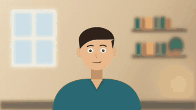
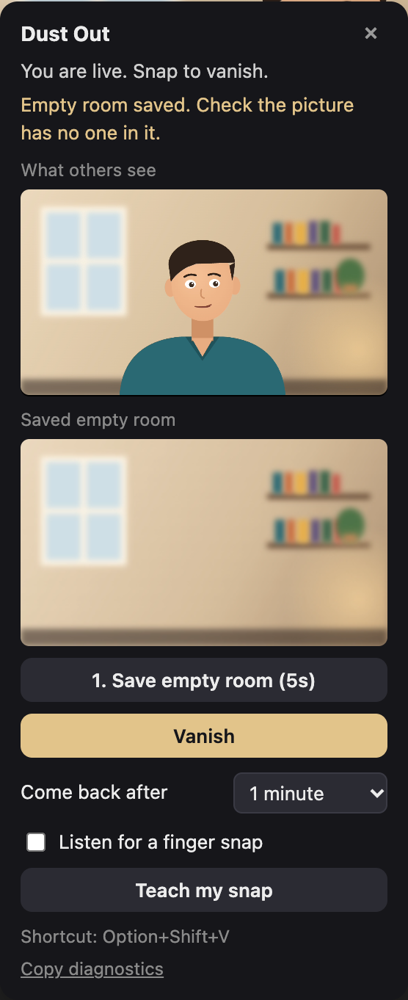

# Dust Out

**Snap your fingers on a video call and crumble into dust. A minute later, you're back.**

Free and open source, for Microsoft Teams and Google Meet in Chrome. No AI, no accounts, and nothing leaves your computer except the video your meeting already sends.



[Install page](https://saimeda32.github.io/dust-out/) · [Download the extension](https://github.com/saimeda32/dust-out/releases/latest/download/dust-out-extension.zip) · [Report a problem](https://github.com/saimeda32/dust-out/issues)

## Contents

- [Pick how to run it](#pick-how-to-run-it)
- [Install](#install)
- [Use it in a call](#use-it-in-a-call)
- [Where it works](#where-it-works)
- [Troubleshooting](#troubleshooting)
- [How it works](#how-it-works) · [Privacy](#privacy) · [Development](#development)

## Pick how to run it

| | Best for | Teams | Google Meet | Setup |
|---|---|---|---|---|
| **[Extension](#extension)** | Most people | Yes | Yes | 2 minutes, once |
| **[Bookmark](#bookmark)** | Extensions blocked, Teams | Yes | **No**, Meet blocks bookmarks | 30 seconds, click before each call |
| **[Console snippet](#console-snippet)** | Extensions blocked, Meet | Yes | Yes | 1 minute once, run before each call |

## Install

### Extension

1. [Download the extension](https://github.com/saimeda32/dust-out/releases/latest/download/dust-out-extension.zip) and unzip it.
2. Open `chrome://extensions` and turn on **Developer mode** (top right).
3. Click **Load unpacked** and choose the `dust-out-extension` folder.
4. Reload any open meeting tabs.

It turns itself on in Teams and Google Meet. For another meeting site, click the Dust Out toolbar button there and choose **Turn on for this site**.

### Bookmark

Drag the button from the [install page](https://saimeda32.github.io/dust-out/#bookmark) to your bookmarks bar (it can't be dragged from GitHub). In your Teams meeting, click it on the screen before you join.

**Teams only.** Google Meet blocks bookmarks, so clicking it there does nothing.

### Console snippet

For Google Meet when extensions are blocked. Code run from Chrome's developer console isn't blocked by Meet.

Once:
1. Click **Copy the code** on the [install page](https://saimeda32.github.io/dust-out/#console).
2. In Chrome press **Cmd+Option+J**, then **Cmd+Shift+P**, type `snippet` and choose **Create new snippet**.
3. Rename it **Dust Out**, paste the code and press **Cmd+S**. If Chrome blocks the paste, type `allow pasting` first.

Each call: on Meet's screen before you join, open the snippet in the **Sources** tab and press **Cmd+Enter**. Or just paste the code into the **Console** and press Enter.

It runs only in that tab until you reload. It's still code your IT team hasn't approved, so use your judgement on a work laptop.

## Use it in a call



1. Open the meeting **in Chrome** with your camera on. The Dust Out card appears at the bottom left.
2. Click **Save empty room** and step out of view for 5 seconds. Check the saved picture has no one in it.
3. **Snap**, or press **Option+Shift+V** (Alt+Shift+V on Windows). Stay seated for about 3 seconds while you crumble.
4. Leave. Everyone sees the empty room. Within a minute the dust flies back, or snap again to return sooner.

**What others see** on the card is exactly what your call sends.

To snap for real instead of using the shortcut: tick **Listen for a finger snap** and use **Teach my snap**, or click **Hand gesture** to snap on camera.

<br clear="right">

## Where it works

| In Chrome | Extension | Bookmark | Console snippet |
|---|---|---|---|
| Microsoft Teams | Works | Works | Works |
| Google Meet | Works* | No, Meet blocks bookmarks | Works* |
| Other browser meetings (Webex, Jitsi, Whereby, Slack huddles) | Works (turn on per site) | Works | Works |
| Zoom in the browser | Not yet | Not yet | Not yet |
| Desktop apps | No | No | No |

\* Turn off Meet's own background effects for the best result: Dust Out works at the camera on Meet, so you'd crumble under them.

## Troubleshooting

- **No card:** the meeting must be open in Chrome, not the desktop app, with your camera on. Extension: click its toolbar button and choose **Show the card**.
- **Bookmark does nothing on Google Meet:** expected. Use the extension or the console snippet.
- **Card shows but snapping does nothing:** save the empty room first, then try **Option+Shift+V**.
- **On Meet, the card asks you to turn your camera off and on:** do that once, so Dust Out can take over the camera.
- **"Couldn't find you":** you were in the saved empty room, or the camera moved. Save it again.
- **Anything else:** click **Copy diagnostics** on the card and paste it into a [new issue](https://github.com/saimeda32/dust-out/issues).

## How it works

Dust Out wraps your outgoing video. On Teams and most sites it hooks the video the meeting sends over WebRTC, after the meeting's own background filter. Google Meet locks that code, so there it wraps the camera instead. It finds you by comparing each frame with the saved empty room, then turns you into particles that keep your real colours and drift away. The meeting app still sees its own video, so nothing else changes. Hand tracking uses Google's MediaPipe model, bundled inside the extension.

## Privacy

No servers, no accounts, no analytics. Dust Out only changes your own outgoing video, only on Teams, Google Meet and sites you turn on. The mic and camera are used only while snap detection is on, and only on your computer.

## Development

```
npm install
npx playwright install chromium   # for the extension tests
npm test                          # build, then run both test suites
```

| Path | What |
|---|---|
| `src/` | The code: `dust-out.js` (effect and hooks), `gesture-detect.js` (hand snap) |
| `extension/` | Chrome extension; `dust-out.js` and `gesture-detect.js` are copied in by the build |
| `bookmarklet/` | Hand-gesture helper for the bookmark version |
| `docs/` | Install page (GitHub Pages), demo, and `character.js` for the cartoon cast |
| `site.template.html` | Source of the install page |
| `test/` | `suite.mjs` (bookmark and console), `ext-suite.mjs` (extension), demo recorders |

`node build.mjs` builds the extension, the install page and the extension zip. `node test/demo-gif.mjs` re-records the demo and the timeline the install page uses to make Alex and Sam react.

## License

MIT. Bundled MediaPipe files are Apache 2.0 (`extension/vendor/mediapipe/LICENSE`).
